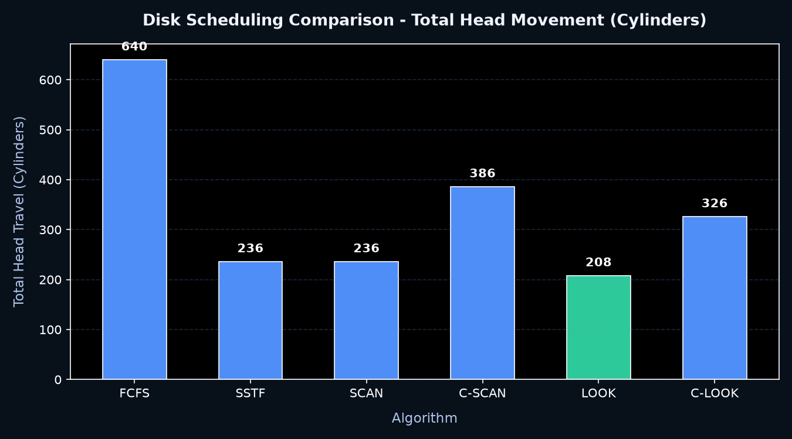
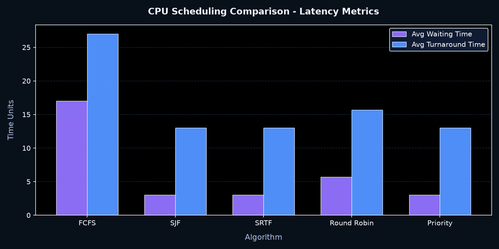
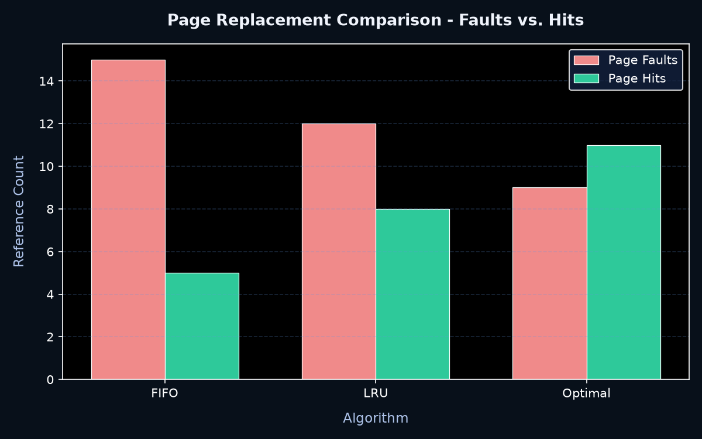

# Operating Systems Resource Manager (OSRM) Laboratory Report
**Academic Course:** Operating Systems Laboratory (ENSC-351), B.Tech Semester V  
**Date of Run:** 2026-11-16 23:33:41  
**Dataset Scale:** SAMPLE Workload Profile  
**Target Environment:** Ubuntu 24.04 LTS (WSL2 / Linux Kernel)  

---

## Executive Summary
This report presents an empirical comparative evaluation of resource allocation, CPU scheduling, 
virtual memory paging, and deadlock avoidance algorithms implemented in the **OS Resource Manager Simulator (osrm)**.
All mathematical computations were executed in pure Python 3 and verified against analytical operating system benchmarks.

---

## 1. Disk Head Scheduling Subsystem

### 1.1 Experimental Configuration
- **Total Cylinders:** 200 (0 to 199)
- **Initial Head Position:** Cylinder 53
- **Initial Arm Direction:** LEFT
- **Track Seek Delay:** 1.0 ms/cylinder
- **Request Queue Length:** 8 cylinders

### 1.2 Quantitative Comparison Matrix
| Algorithm | Head Movement (Cylinders) | Average Seek Length | Seek Delay (ms) | Efficiency Rank |
| :--- | :---: | :---: | :---: | :---: |
| **LOOK** | 208 | 26.0 | 208.0 | #1 |
| **SSTF** | 236 | 29.5 | 236.0 | #2 |
| **SCAN** | 236 | 29.5 | 236.0 | #3 |
| **C-LOOK** | 326 | 40.75 | 326.0 | #4 |
| **C-SCAN** | 386 | 48.25 | 386.0 | #5 |
| **FCFS** | 640 | 80.0 | 640.0 | #6 |

### 1.3 Analytical Findings
**Benchmark Summary:** Under this workload, **LOOK** demonstrated optimal efficiency with only 208 cylinder movements (208.0 ms seek delay), representing a 67.5% reduction compared to FCFS (640 cylinders).

- **SSTF Starvation Risk:** While SSTF minimizes immediate seek times, it exhibits susceptibility to starvation if an incoming stream of requests clusters near the current cylinder head, indefinitely deferring peripheral cylinders.
- **SCAN / C-SCAN Uniformity:** SCAN provides bounded response times by traversing bidirectional sweeps. C-SCAN enhances fairness by strictly servicing in one direction; its return jump carries the head back without servicing, ensuring uniform wait-time variance across both outer and inner tracks.
- **LOOK / C-LOOK Efficiency:** LOOK and C-LOOK eliminate redundant head travel to track extremes (0 and max cylinder) by reversing or jumping immediately after servicing the outermost pending request in the active queue direction.

---

## 2. CPU Scheduling Subsystem

### 2.1 Experimental Configuration
- **Active Processes:** 3 processes
- **Round Robin Time Quantum:** 4.0 time units

### 2.2 Quantitative Comparison Matrix
| Algorithm | Avg Waiting Time | Avg Turnaround | Avg Response | CPU Utilization | Throughput (proc/unit) |
| :--- | :---: | :---: | :---: | :---: | :---: |
| **SJF** | 3.0 | 13.0 | 3.0 | 100.0% | 0.1 |
| **SRTF** | 3.0 | 13.0 | 3.0 | 100.0% | 0.1 |
| **Priority** | 3.0 | 13.0 | 3.0 | 100.0% | 0.1 |
| **Round Robin** | 5.67 | 15.67 | 3.67 | 100.0% | 0.1 |
| **FCFS** | 17.0 | 27.0 | 17.0 | 100.0% | 0.1 |

### 2.3 Analytical Findings
**CPU Scheduling Insights:** **SJF** achieved the lowest average waiting time of 3.00 time units.

- **SJF / SRTF Optimality:** Shortest Job First provably minimizes average waiting time for batch systems, though preemptive Shortest Remaining Time First (SRTF) can introduce context-switching overhead.
- **Round Robin Fairness:** Round Robin eliminates process starvation and guarantees predictable response latency. The choice of time quantum is critical: too small causes excessive context switches; too large degenerates to FCFS.
- **Priority Scheduling:** Non-preemptive priority honors process urgency but requires an aging mechanism in production to prevent low-priority process starvation.

---

## 3. Page Replacement Subsystem

### 3.1 Experimental Configuration
- **Allocated Physical Frames:** 3 frames
- **Reference Stream Length:** 20 virtual accesses

### 3.2 Quantitative Comparison Matrix
| Algorithm | Page Faults | Page Hits | Fault Ratio | Hit Ratio |
| :--- | :---: | :---: | :---: | :---: |
| **Optimal** | 9 | 11 | 45.0% | 55.0% |
| **LRU** | 12 | 8 | 60.0% | 40.0% |
| **FIFO** | 15 | 5 | 75.0% | 25.0% |

### 3.3 Belady's Anomaly Verification
- **Test Sequence:** `[1, 2, 3, 4, 1, 2, 5, 1, 2, 3, 4, 5]`
- **FIFO with 3 Frames:** 9 Faults
- **FIFO with 4 Frames:** 10 Faults
- **Empirical Verdict:** **Anomaly Confirmed.** Increasing physical frames from 3 to 4 resulted in an increased fault rate (+1 fault).

---

## 4. Deadlock Avoidance (Banker's Algorithm)

### 4.1 System State Verification
- **Total Resource Types:** 3
- **Initial Available Vector:** `[3, 3, 2]`
- **System Safety Status:** **SAFE**
- **Computed Safe Execution Order:** `P1 -> P3 -> P4 -> P0 -> P2`

### 4.2 Dynamic Resource Request Evaluation
- **Requesting Process:** `P0`
- **Requested Vector:** `[1, 1, 1]`
- **Arbitration Verdict:** **GRANTED**
- **Evaluation Rationale:** GRANTED: Request can be safely allocated immediately. Resulting safe sequence: P3 -> P4 -> P1 -> P2 -> P0.

---

## 5. System Architecture & Academic Conclusions
1. The unified architecture ensures that identical core algorithmic logic feeds both the interactive terminal menus and the responsive web dashboard.
2. Complete input verification shields the simulation core from runtime exceptions on malformed boundary data.
3. Static SVG/PNG figures and step traces generated by this suite have been preserved under `output/charts/` and `output/traces/`.

*Report generated by OSRM Subsystem Build v1.0.0.*
